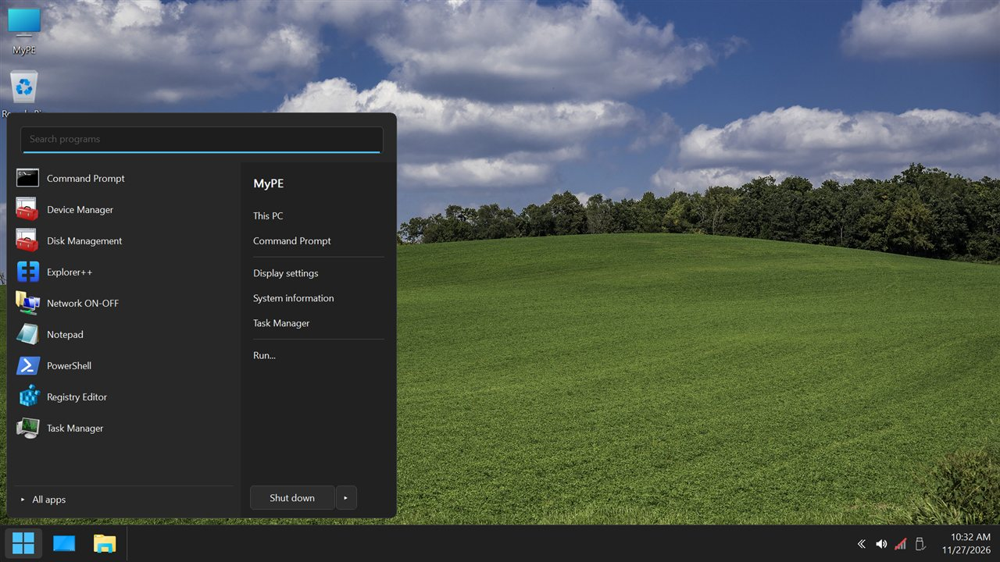
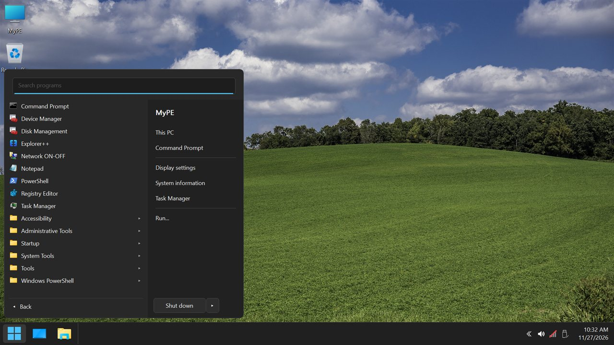
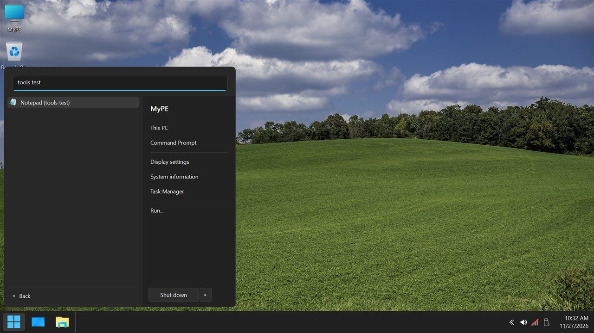
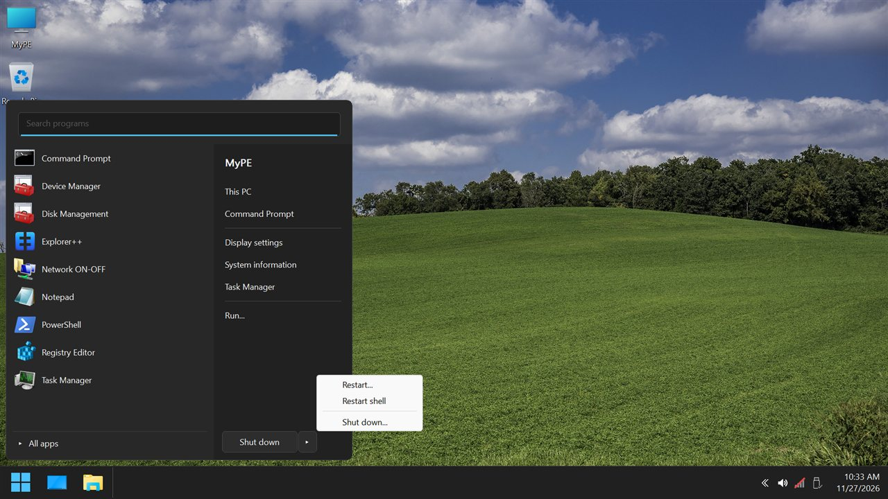

# WinPE-Shell

A lightweight desktop shell for **Windows PE** (WinPE / WinRE based images, Windows 11 24H2/25H2/26H2, x64): desktop,
taskbar, Start menu and notification area, plus a companion utility for what a recovery environment usually lacks:
a shutdown dialog, a Display window (multi-monitor, live scale, brightness), a network switch that keeps the network
**off until you turn it on**, a volume icon and system information.

WinPE-Shell is a fork of the shell part of [PExplorer](https://github.com/slorelee/PExplorer) (WinXShell shell part,
by slorelee), itself based on the ReactOS Explorer. It is built entirely from source with the Microsoft build tools;
no prebuilt third-party binaries are used.

> Status: works in our own WinPE build (VMware; real hardware: AMD GPU with two monitors, Realtek Ethernet). No fixed
> folder: every program finds its configuration and logs next to its own exe (`<exe dir>\config`, `<exe dir>\logs`).



| All apps | Search | Shut down menu |
|---|---|---|
|  |  |  |

Screenshots: WinPE 26H2 in a VM at 150 % scale (`"style": "win11"`, the right column title comes from
`win7.title`); desktop background: a CC0 / public domain photo.

## 1. Components

| Component | Path | Output | What it does |
|---|---|---|---|
| Shell | `src/` | `WinPE-Shell.exe` | Desktop, taskbar, Start menu, tray, desktop context menu |
| UI utility | `ui/` | `WinPE-ShellUI.exe` | Shutdown dialog, Display window + live scale, network ON/OFF + Wi-Fi, volume icon, `ms-settings:` handler |
| WinPE helpers | `winpe/` | `WinPE-ShellStart.exe`, `DisplayLayout.dll`, 2 scripts | Startup launcher + shell watchdog, display layout at boot, system information |
| Test tools | `tools/test/` | `DlgTest`, `ShellStress`, `ShellDump`, `DpiTest` | Checks inside a test VM (optional) |

## 2. Features

### Shell (`WinPE-Shell.exe`)
- Desktop with icons, wallpaper or solid colour, the standard shell view menus (View, Sort by, Refresh, Paste, New).
- Taskbar with Start button, quick launch, task buttons, notification area and clock.
- **Windows 11 look** (`JS_TASKBAR.style = "win11"`): icon-only task buttons with rounded hover / active backgrounds
  and a running indicator, Windows logo Start button, Segoe UI clock, icons left (default) or centered.
- Start menu: classic cascading menu, or a two-column menu (`win7` / `win11` look) with pinned programs, All Programs
  tree, search (Enter without a match runs the text), configurable right column, Shut down + Restart menu, and
  programs found **at run time** in folders on the boot stick (`extra_folders`).
- Desktop context menu (each entry configurable / hideable): Display settings, System properties, Open command window
  here, Restart shell, Restart..., Shut down... Alt+F4 on the desktop opens the shutdown dialog.
- Folder windows can be handed to a third-party file manager (for example Explorer++).
- System DPI aware; "Restart shell" exits with code `0x7F04` so a launcher's watchdog can tell it from a crash.
- Optional "x" on the hovered task button to close that window (`JS_TASKBAR.task_close_button`).
- "Show desktop" strip at the right end of the taskbar (as in Windows 7-11).
- Pinned programs defined at run time, also for programs added after the build (boot stick): Start menu right click
  "Pin to Start" / "Pin to taskbar", kept in a pins file (`JS_STARTMENU.pins_file`).

### UI utility (`WinPE-ShellUI.exe`)

| Command | What it does |
|---|---|
| `WinPE-ShellUI shutdown\|restart [/dryrun]` | Shutdown dialog: semi-opaque overlay on every monitor, Restart / Shut down; Esc or a click outside cancels |
| `WinPE-ShellUI open display [/select N]` | Display window |
| `WinPE-ShellUI open network` | Network window |
| `WinPE-ShellUI open sysinfo` | System information (pluggable: a command line in `winpe-shellui.ini`) |
| `WinPE-ShellUI uri <uri>` | Handler for `ms-settings:` and `ms-availablenetworks:` |
| `WinPE-ShellUI net on\|off\|toggle\|status [/quiet] [/boot]` | Network control |
| `WinPE-ShellUI tray-net` | Network icon in the tray |
| `WinPE-ShellUI tray-vol` | Volume icon in the tray |
| `WinPE-ShellUI scale <percent> [/norestart]` | Live display scale on every display (restarts the shell if it changed) |
| `WinPE-ShellUI calendar` | Calendar above the clock: time, long date, month view (Esc or a click elsewhere closes it) |
| `WinPE-ShellUI snip [/now]` | Snipping tool: New (rectangular / full-screen snip), Save As (PNG, JPEG, BMP), Copy; the snip goes to the clipboard. `/now` = snip at once (Print Screen) |
| `WinPE-ShellUI dim <20..100>` | Dims the screen when its brightness cannot be set (no WMI panel / DDC/CI): gamma ramp of the display driver (no extra memory), else a click-through dimming layer (without DWM it costs 4 bytes of RAM per pixel while the screen is dimmed: about 8 MB for 1920x1080, 33 MB for 3840x2160). `100` ends it. The Display window's brightness row uses it for such monitors |
| `WinPE-ShellUI tray-bat` | Battery icon in the tray (charge, charging / plugged in / time left); ends at once on a PC without a battery |
| `WinPE-ShellUI bitlocker [X:] [/check]` | Unlocks BitLocker drives: locked drives, password or 48-digit recovery key (BitLocker WMI through PowerShell; the secret goes on standard input, never on a command line or into a log). `/check` = only if a drive is locked (start-up step) |

**Display window**: monitors drawn by their real position; Extend / Duplicate / only display N; per display
resolution, refresh rate, orientation, main display; every change with a 15 s "Keep changes?" countdown and automatic
revert; brightness for laptop panels (WMI) and external monitors (DDC/CI, `dxva2.dll`); **live scale** from 100 % up to
the largest scale every display accepts, the same on all displays (the shell is system DPI aware), re-applied after a
layout change or a revert; "Save as default". Works with the Basic Display Adapter.

**Network** (for images where the network stays off until the user turns it on): `net off /boot` verifies the OFF
state at start; `net on` installs drivers for adapters without one, starts the services in order, `wpeutil
InitializeNetwork`, waits for a DHCP lease and checks DNS; `net off` disconnects and disables the adapters. Tray icon
(off / turning on / connected), network window with adapters, IP, DNS and a Wi-Fi list (WPA2/WPA3-Personal through a
temporary profile that is never stored). A state left behind by a killed process is reset.

**Volume icon**: level / mute icon of the default playback device, volume window (slider, Mute, Mixer), menu (Mute,
Volume mixer, Sound settings); follows device changes and live scale changes.

### WinPE helpers (`winpe/`)
- **`WinPE-ShellStart.exe`** (C, no console): the only `winpeshl.ini` entry. Runs `wpeinit`, then the steps of
  `<exe dir>\config\startup.ini` `[run]` (`wait|`, `nowait|`, `wait<seconds>|` = wait at most that long), then starts
  the shell and restarts it when it exits. Crashes: at most 4 starts in 60 s, then a rescue command prompt; requested
  restarts (exit codes `0x7F04` / `0x7F05`) have their own, larger limit. A hung shell (its taskbar window does not
  answer for about 2 minutes) is ended with `0x7F06` and restarted like a crash. Log: `<exe dir>\logs\startup.log`.
  The scripts use the folder above their `bin\` (`<base>\config`, `<base>\logs`, `<base>\WinPE-ShellUI.exe`).
- **`DisplayLayout.dll`** (C#, P/Invoke only) + **`Set-DisplayLayout.ps1`**: at boot, waits for the GPU driver, sets
  Extend mode, the native resolution / refresh of every monitor, the main display and positions from `display.json`,
  falls back to one monitor on the Basic Display Adapter, then applies the default scale live (`WinPE-ShellUI scale`). A
  `display.json` on the boot stick overrides the scale: `-StickMarker` (default `MyPE\mype-stick`, the same file as
  `extra_folders_marker`) marks the stick, `-StickConfig` (default `MyPE\config\display.json`) is the file read there;
  `-StickMarker ''` turns this off.
- **`Show-SystemInfo.ps1`**: read-only system report (system, firmware / Secure Boot, CPU, memory modules, graphics,
  disks and volumes, network adapters) shown in Notepad; used as `sysinfo=` in `winpe-shellui.ini`.

## 3. Build

Requirements: Windows 10/11 x64, **Visual Studio 2022 Build Tools** with *Desktop development with C++* (MSVC v143)
and the **Windows 11 SDK 10.0.26100**. No NuGet, vcpkg, CMake or network access during the build.

```powershell
git clone https://github.com/selvent12/WinPE-Shell.git
cd WinPE-Shell
.\build.ps1                        # shell + UI utility
.\build.ps1 -TestTools             # + test tools
.\build.ps1 -VsPath D:\BuildTools  # if vswhere cannot find Build Tools
```
Output: `out\shell\WinPE-Shell.exe`, `out\ui\WinPE-ShellUI.exe`, `out\winpe\` (WinPE-ShellStart.exe, DisplayLayout.dll built with the
Windows .NET Framework 4 `csc.exe`, the two scripts), `out\test\*.exe`, logs and `out\build-sha256.csv` (SHA256 and
PE machine of every binary). The shell treats the x64 truncation warnings (C4311/C4312/C4302/C4244/C4267/C4090) as
errors; the UI utility builds with `/W4 /WX`. MSVC binaries are not bit-for-bit reproducible across machines: if you
keep an allowlist of hashes, re-approve after each build.

CI: `.github/workflows/build.yml` runs the same `build.ps1 -TestTools` on a GitHub Windows runner (preinstalled
VS 2022 + Windows SDK, read-only token, no extra downloads) and uploads the binaries with `build-sha256.csv`.
Releases: a tag `v*` runs `.github/workflows/release.yml`, which builds the same way and attaches
`WinPE-Shell-<tag>-x64.zip` (+ `.sha256`) and `build-sha256.csv` to a GitHub release.

## 4. Configuration

### Shell: `WinPE-Shell.jcfg` (JSON next to `WinPE-Shell.exe`)
```json
{
  "JS_FILEEXPLORER": { "3rd_filename": "X:\\Program Files\\Explorer++\\Explorer++.exe",
                       "3rd_open_arguments": "\"%s\"", "hook_GetShellWindow": false },
  "JS_DESKTOP": { "bkcolor": [30, 34, 48], "wallpaperstyle": 0,
                  "wallpaper": [ "*:\\MyPE\\config\\wallpaper.jpg", "X:\\MyPE\\wallpaper.jpg" ],
                  "menu": { "display":  { "command": "X:\\Tools\\WinPE-ShellUI.exe", "parameters": "open display" },
                            "sysprops": { "command": "X:\\Tools\\WinPE-ShellUI.exe", "parameters": "open sysinfo" },
                            "cmdhere":  { "hide": true } } },
  "JS_TASKBAR": { "theme": "dark", "style": "win11", "align": "left", "height": 48, "smallicon": 32,
                  "bkcolor": [32, 32, 32] },
  "JS_STARTMENU": {
    "style": "win11",
    "extra_folders": [ "*:\\MyPE\\Programs" ],
    "extra_folders_marker": "MyPE\\mype-stick",
    "commands": { "reboot":   { "command": "X:\\Tools\\WinPE-ShellUI.exe", "parameters": "restart" },
                  "shutdown": { "command": "X:\\Tools\\WinPE-ShellUI.exe", "parameters": "shutdown" } },
    "win7": { "title": "WinPE", "pinned": [ "Command Prompt" ],
              "right": [ { "text": "This PC", "command": "::explorer" }, {}, { "text": "Run...", "command": "::run" } ],
              "width_left": 300, "width_right": 200, "height": 520 }
  }
}
```
- `JS_FILEEXPLORER.3rd_filename`: program for folder windows (`%s` = folder); `hook_GetShellWindow: false` recommended.
- `JS_DESKTOP.wallpaper`: one BMP/JPG path, or a list of candidates - the first existing file wins. `*:\` = that file
  on every fixed / removable drive that contains `wallpaper_marker` (default: `JS_STARTMENU.extra_folders_marker`), so
  a picture on the boot stick replaces the default without a new image; the internal disk is never used.
  `wallpaperstyle`: 0 = stretched to the screen. `winpe\New-Wallpaper.ps1` draws a default (`-Style hills`: sky,
  clouds, green hills; `-Style dark`), own drawing, no third-party picture.
- `JS_DESKTOP.menu.<key>` (`display`, `sysprops`, `cmdhere`, `restartshell`, `restart`, `shutdown`): `command`,
  `parameters`, `text`, `hide`. URI commands are started with the protocol class.
- `JS_TASKBAR.style`: `"classic"` (default) or `"win11"`; `align` (win11): `"left"` (default) or `"center"`;
  `smallicon` as a number = icon size (96 DPI). Values are case-insensitive and read once at start.
- `JS_TASKBAR.clock_command` `{ "command", "parameters" }`: run on a click on the clock (e.g. `WinPE-ShellUI.exe
  calendar`); without it a double click opens the Date and Time panel.
- `JS_HOTKEY.printscreen` `{ "command", "parameters" }`: Print Screen runs it (e.g. `WinPE-ShellUI.exe snip /now`);
  the key is registered only when a command is set.
- `JS_TASKBAR.task_close_button` (default `false`): an "x" in the corner of the hovered task button closes the window.
- `JS_TASKBAR.visible` (default `true`): `false` = no taskbar (same as `notaskbar: true`, the name WinXShell uses).
- `JS_TASKBAR.disable_showdesktop` (default `false`): no Win+D and no "show desktop" quick launch button.
- `JS_NOTIFYAREA.hide_toggle_button` (default `false`): no button for the hidden notification icons.
- `JS_NOTIFYCLOCK.visible` (default `true`): `false` = no clock.
- `JS_NOTIFYAREA.hide_showdesktop_button` (default `false`): no "show desktop" strip right of the clock.
- `JS_QUICKLAUNCH.visible` (default `true`): `false` = no quick launch bar (and so no taskbar pins).
- `JS_STARTMENU.start_icon`: `"empty"`, or the path of an `.ico` file drawn instead of the Windows logo.
- `JS_STARTMENU.pins_file`: list of ini files, `*:\` = the drive with `extra_folders_marker` (the boot stick), e.g.
  `[ "*:\MyPE\config\pins.ini", "X:\MyPE\config\pins.ini" ]`. Read: the first existing file. Written by the
  Start menu's "Pin to ..." (right click on a program): the first file whose folder exists or can be made, so pins
  made with the stick present stay on the stick (a new file starts as a copy of the one read so far). Sections
  `[start]` (added to the left column) and `[taskbar]` (shortcuts in the quick launch folder, made at shell start):
  one entry per line, a name as in All Programs (`Folder\Name`) or a file path (`*:\` allowed).
- `JS_DESKTOP.restart_on_resolution_change` (default `true`): when the main display's resolution changes (Display
  window, or a program that switches the mode itself), the shell restarts after 2 s so desktop and taskbar icons are
  redrawn at the new size.
- `JS_STARTMENU.style`: `"classic"` (default), `"win7"` (two columns) or `"win11"` (same menu, Windows 11 look:
  search on top, rounded corners, floating, centered with `align: center`).
  - `win7.pinned`: left column (names as in All Programs, `Folder\\Name`); default = shortcuts directly in Programs.
  - `win7.right`: right column, `{}` = separator; special commands `::explorer`, `::run`, `::restart`, `::shutdown`.
  - `norestart`, `noshutdown`, `norun` hide entries. Keys: Ctrl+Esc, Esc, arrows, Enter, Left/Right.
  - `extra_folders`: folders read at run time and merged into Programs (`*:\` = that folder on every fixed or removable
    drive; scanned on a background thread). Only launchable files (`.lnk .exe .url .msc .bat .cmd`), hidden files
    skipped. `extra_folders_marker`: a `*:\` pattern only matches drives that contain this file (the boot stick), so the
    internal disk of the PC being examined cannot add Start menu entries.

### UI utility: `winpe-shellui.ini` (UTF-16, `<exe dir>\config\winpe-shellui.ini`, former name `mypeui.ini` still read; log `<exe dir>\logs\winpe-shellui.log`)
```ini
[features]
display=enabled           ; enabled = built-in window, empty = "not available yet", other = command line to run
network=enabled
sysinfo=<command line>    ; e.g. a PowerShell script that shows system information

[network]
mode=manual               ; manual | full-off | noNicKeepTcpip
onServices=BFE,MpsSvc,nsi,Dhcp,Dnscache,NlaSvc,lmhosts,LanmanWorkstation,WlanSvc
offServices=WlanSvc,LanmanWorkstation,lmhosts,NlaSvc,Dhcp
bootDisabled=Dnscache
waitSeconds=60
dnsTestName=
```
Links handed to a configured command are passed as one quoted argument; links with quotes or control characters are
refused. Network intent is kept in `HKLM\SOFTWARE\WinPE-Shell\Network` (`State`) in the RAM registry.

## 5. Using it in a WinPE image
All files below are **Microsoft files from the ADK or from the matching `install.wim`**; nothing third-party is needed.

### Dependencies

| Needed by | WinPE optional components (ADK `WinPE_OCs`) | Files / services (from `install.wim` unless in WinPE already) |
|---|---|---|
| Shell (`WinPE-Shell.exe`) | none | `shell32`, `comctl32` v6, `shlwapi`, `uxtheme`, `dwmapi`, `msimg32` (in WinPE); the **`Windows\SystemResources\*.mun`** of every binary in the image (Windows 11 keeps system icons there: without them the Open/Save dialog crashes and MMC fails); the `en-US\*.mui` of every added file |
| Folder windows (optional) | none | a file manager such as Explorer++ (`JS_FILEEXPLORER.3rd_filename`); the native folder window hangs in WinPE |
| UI utility (`WinPE-ShellUI.exe`) | WinPE-WMI (brightness of laptop panels, `root\wmi`) | `iphlpapi`, `setupapi`, `cfgmgr32`, `newdev`, `dnsapi`, `wpeutil`, `drvload` (in WinPE); `dxva2.dll` (DDC/CI brightness of external monitors, loaded at run time); `ieframe.dll` (URI parsing: without it `start ms-settings:...` fails with "The specified module could not be found") |
| Network window / Wi-Fi | (WinRE base: networking present) | network services `BFE MpsSvc nsi Dhcp Dnscache NlaSvc lmhosts LanmanWorkstation`; Wi-Fi: `WlanSvc`, `wlanapi.dll` (loaded at run time), `nwifi.sys`, WLAN profile / security DLLs; NIC / Wi-Fi drivers |
| Volume icon | none | Core Audio (`AudioSrv`, `AudioEndpointBuilder`, `mmdevapi.dll`, `audioses.dll`), the in-box audio driver packages (`hdaudbus`, `hdaudio`, `ks`, `wdmaudio`, `usbaudio2`, ...), optional `SndVol.exe` (mixer) and `mmsys.cpl` (Sound panel) |
| Live display scale | none | `user32` DisplayConfig (in WinPE); the shell's manifest is system DPI aware |
| `WinPE-ShellStart.exe` | none | `wpeinit` (in WinPE); `cmd.exe` as the rescue prompt |
| `Set-DisplayLayout.ps1` + `DisplayLayout.dll` | WinPE-WMI, WinPE-NetFx, WinPE-Scripting, WinPE-PowerShell | .NET Framework 4 (`Add-Type` of the DLL) |
| `Show-SystemInfo.ps1` | WinPE-WMI, WinPE-NetFx, WinPE-Scripting, WinPE-PowerShell, WinPE-StorageWMI, WinPE-SecureBootCmdlets | `notepad.exe` to show the report |

- **Files**: `WinPE-Shell.exe` + `WinPE-Shell.jcfg` (any folder, e.g. `X:\Program Files\WinPE-Shell`);
  `WinPE-ShellUI.exe` and `WinPE-ShellStart.exe` in one folder `<dir>` with `<dir>\config\` (`winpe-shellui.ini`,
  `startup.ini`, `display.json`) and `<dir>\logs\` (created at run time); the scripts and `DisplayLayout.dll` in
  `<dir>\bin\`.
- **Registry** (offline): `Classes\ms-settings` and `ms-availablenetworks` -> `"<dir>\WinPE-ShellUI.exe" uri "%1"`; remove
  leftover `DesktopBackground\Shell\*` verbs; per-user settings in `HKU\.DEFAULT` (the shell runs as SYSTEM); network
  off by default (`EnableNetwork=false` in `Unattend.xml`, services on demand, `Dnscache` disabled at boot).
- **Startup**: `winpeshl.ini` starts one long-running launcher that runs `wpeinit`, the startup steps (`net off /boot`,
  `tray-net`, `tray-vol`, a display layout script) and then starts and watches the shell (restart on exit; treat exit
  code `0x7F04` as a requested restart). If the last program in `winpeshl.ini` exits, WinPE reboots.
- **DPI**: `LogPixels` is read at session start only, but the per-monitor scale can be changed live
  (`WinPE-ShellUI scale`); processes started afterwards get the new DPI, so a shell restart draws the taskbar sharp.
- The Windows 11 `explorer.exe` cannot be the WinPE shell (its taskbar needs AppX/XAML and a real logon session).

## 6. Changes compared with upstream
Base: PExplorer branch `WinXShell_shellpart` @ `5f8b886` (2018-08-19).
- **01-06** VS 2022 (v143) + Windows 11 SDK; no `-install` (no `Winlogon\Shell` write); no `Run`/`RunOnce` processing;
  no `wsock32`; empty / not-ready drives as empty folders; x64 clean (truncation warnings are errors).
- **07** Desktop context menu (Display settings, System properties, Open command window here, Restart shell, Restart,
  Shut down); "Restart shell" = clean exit with an 8 s guard.
- **08** Two-column Start menu (`win7`) + `extra_folders` (background scan).
- **09** Windows 11 look (`JS_TASKBAR.style = "win11"`, `align`; `JS_STARTMENU.style = "win11"`).
- **10** System DPI aware manifest; live display scale in the utility.
- **11** One scale on all displays (smallest maximum), re-applied after a layout change.
- **12** Review fixes: icons without a C: drive, classic look not DPI-scaled twice, exit code `0x7F04` for a requested
  restart, centered layout without flicker, narrow screens, `start_icon: "empty"` in win11 style, repaint only on a
  foreground change, thread-safe `extra_folders` at exit, case-insensitive values, `WINPESHELL_FEATURES=` marker string;
  utility: one restart per Apply, brightness worker with its own target list, URI checks, stale network state reset,
  volume icon.
- **13** `extra_folders_marker` (boot stick only); volume icon: icon size follows live scale changes, the slider
  follows outside volume changes, logging limited, stale audio enumerator re-created.
- **14** WinPE helpers moved here from the image builder: startup launcher / watchdog, display layout, system
  information (`winpe/`, built by `build.ps1`).
- **15** Names: `WinPE-Shell.exe` (+ `WinPE-Shell.jcfg`, `WinXShell.jcfg` still read), `WinPE-ShellUI.exe`,
  `WinPE-ShellStart.exe`; configuration and logs relative to the exe folder; registry key
  `HKLM\SOFTWARE\WinPE-Shell\Network`; window classes / mutexes `WinPE-Shell.*`; wallpaper list.
- **16** Public release preparation: neutral internal names (`ShellStress`, `ShellDump`, `WPS_*` identifiers), the
  boot-stick paths of `Set-DisplayLayout.ps1` as parameters, current screenshots, release workflow.
- **17** Fixes from a test on real hardware: calendar on a clock click, snipping tool + Print Screen, shell restart
  after a resolution change, the Display window scrolls when it does not fit the screen (low resolution).
- **18** Fixes and options taken over from the later PExplorer `WinXShell` branch (rewritten here, no Lua): quick
  launch rescanned only when its folder changed (was every second), Start menu guard for an empty / scrolled list,
  tray icons of version 4 and later; the secure CRT functions were silently mapped to the unbounded ones (`_MS_VER`
  typo in the ReactOS code) - fixed, and the remaining unbounded string copies replaced; hang detection in the
  watchdog; task "x" button, `visible` / `disable_showdesktop` / `hide_toggle_button` / clock `visible` options;
  `dim` (screen dimming) and `bitlocker` (unlock) in the utility; "show desktop" strip, Start button picture from an
  `.ico` file, quick launch `visible`, run-time pins (Start menu / taskbar, pins file on the boot stick), `tray-bat`.

## 7. License and credits
- Shell (`src/`): GNU LGPL 2.1 or later, as the upstream sources. Descends from the **ReactOS Explorer** (Copyright the
  ReactOS project and Martin Fuchs) and **PExplorer / WinXShell shell part** by slorelee
  (https://github.com/slorelee/PExplorer, branch `WinXShell_shellpart`, commit `5f8b886f`, full history kept here).
- `src/vendor/json.*`: Copyright (c) 2013 Jeff Weinstein, MIT License (`src/vendor/LICENSE`).
- UI utility (`ui/`), WinPE helpers (`winpe/`), test tools, build scripts and documentation: selvent12, GNU LGPL 2.1
  or later.
- The utility's features were designed from public documentation and observed behaviour; no code from closed-source
  shells was used. "Windows" is a trademark of Microsoft Corporation; this project is not affiliated with Microsoft,
  ReactOS or the authors of WinXShell.

Full text: [LICENSE](LICENSE).
