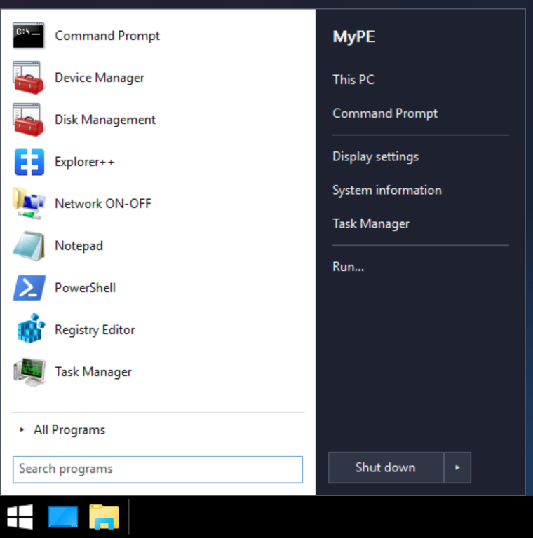
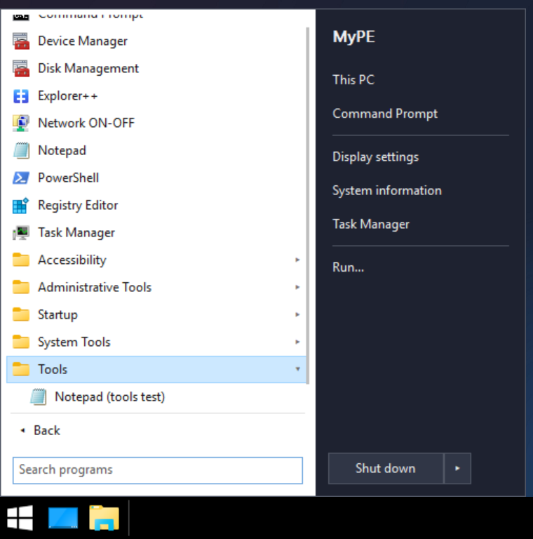
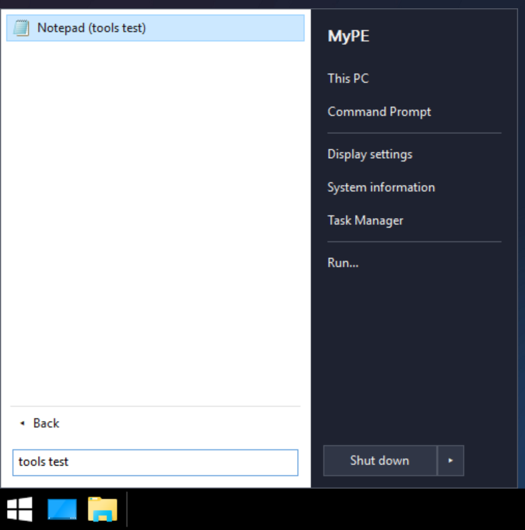
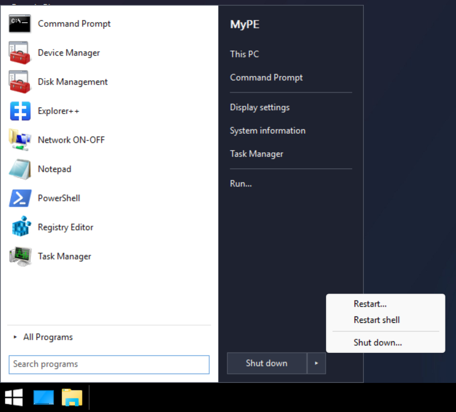

# Configuration

## Shell: `WinXShell.jcfg`
JSON file next to `WinXShell.exe`. The keys are those of the upstream shell (see `src/WinXShell.jcfg` for the full
list with comments). Commonly used:

```json
{
  "JS_FILEEXPLORER": { "3rd_filename": "X:\\Program Files\\Explorer++\\Explorer++.exe",
                       "3rd_open_arguments": "\"%s\"", "hook_GetShellWindow": false },
  "JS_DESKTOP": { "bkcolor": [30, 34, 48], "wallpaper": "X:\\wallpaper.jpg", "wallpaperstyle": 0,
                  "menu": {
                    "display":  { "command": "ms-settings:display" },
                    "sysprops": { "command": "X:\\Tools\\MyPEUI.exe", "parameters": "open sysinfo" },
                    "cmdhere":  { "hide": true }
                  } },
  "JS_TASKBAR": { "theme": "dark", "height": 40 },
  "JS_STARTMENU": { "commands": {
      "reboot":   { "command": "X:\\Tools\\MyPEUI.exe", "parameters": "restart" },
      "shutdown": { "command": "X:\\Tools\\MyPEUI.exe", "parameters": "shutdown" } } }
}
```

- `JS_FILEEXPLORER.3rd_filename`: program used for folder windows (`%s` = folder). `hook_GetShellWindow: false`
  is recommended (the hook patches `user32!GetShellWindow` in memory and is only needed for the built-in folder window).
- `JS_DESKTOP.menu.<key>` with keys `display`, `sysprops`, `cmdhere`, `restartshell`, `restart`, `shutdown`.
  Fields: `command`, `parameters`, `text` (menu caption), `hide` (true/false).
  Without `command`, `restart`/`shutdown` use the `JS_STARTMENU.commands` entries and `restartshell` ends the shell
  process (a launcher/watchdog must restart it). URI commands (`ms-settings:...`) are started with the protocol class.
- `JS_STARTMENU.commands.reboot` / `shutdown`: what Restart / Turn Off run.

### Start menu style: `JS_STARTMENU.style`
`"classic"` (default) = the cascading menu; `"win7"` = a two-column menu:

| Home | All Programs | Search | Shut down menu |
|---|---|---|---|
|  |  |  |  |

```json
"JS_STARTMENU": {
  "style": "win7",
  "extra_folders": [ "*:\\Programs", "%SystemDrive%\\Tools" ],
  "win7": {
    "title": "WinPE",
    "pinned": [ "Command Prompt", "Tools\\Notepad2" ],
    "right": [
      { "text": "This PC", "command": "::explorer" },
      { "text": "Command Prompt", "command": "X:\\Windows\\System32\\cmd.exe" },
      {},
      { "text": "Display settings", "command": "ms-settings:display" },
      { "text": "Run...", "command": "::run" }
    ],
    "width_left": 300, "width_right": 200, "height": 520
  }
}
```

- Left column: `win7.pinned` (names as shown in All Programs, `Folder\\Name` for sub-folders); without it, every
  shortcut directly in `Start Menu\Programs`. **All Programs** shows the whole tree (folders open in place), the
  search box filters all shortcuts by name; Enter without a match runs the text as a command (like Run...).
- `extra_folders`: folders read **at run time** and shown like an extra `Start Menu\Programs` (merged with it), so
  programs copied there later appear without changing the image. `*:\` = that folder on every fixed or removable
  drive (CD/DVD and network drives are skipped). Only launchable files are listed (`.lnk .exe .url .msc .bat .cmd`);
  folders without any are hidden. The drives are scanned on a background thread when the shell starts and each time
  the menu opens; the result is merged as soon as it arrives.
- `win7.right`: links of the right column. `{}` = separator. Special commands: `::explorer` (folder window /
  `JS_FILEEXPLORER.3rd_filename`), `::run`, `::restart`, `::shutdown`. Default: This PC, Command Prompt,
  Display settings, Task Manager, Run....
- `win7.title`: optional header of the right column. Sizes are at 96 DPI and scaled.
- Bottom right: **Shut down** (`commands.shutdown`) and an arrow menu (Restart..., Restart shell, Shut down...).
  `norestart`, `noshutdown`, `norun` hide the matching entries.
- Keys: Ctrl+Esc opens, Esc closes (or clears the search / leaves All Programs), arrows + Enter, Left/Right
  close/open a folder.

## UI utility: `mypeui.ini`
UTF-16 INI file, currently at `X:\MyPE\config\mypeui.ini` (log: `X:\MyPE\logs\mypeui.log`; both paths will become
configurable).

```ini
[features]
display=enabled           ; enabled = built-in window, empty = "not available yet", other = command line to run
network=enabled
sysinfo=

[network]
mode=manual               ; manual | full-off | noNicKeepTcpip
onServices=BFE,MpsSvc,nsi,Dhcp,Dnscache,NlaSvc,lmhosts,LanmanWorkstation,WlanSvc
offServices=WlanSvc,LanmanWorkstation,lmhosts,NlaSvc,Dhcp
bootDisabled=Dnscache     ; services that must stay disabled at boot and are enabled by "net on"
waitSeconds=60
dnsTestName=              ; optional public name resolved after "net on" (empty = no external query)
```

Network state (intent) is kept in `HKLM\SOFTWARE\MyPE\Network` (`State` = on/off/turning-on/turning-off) in the
RAM registry of the running PE.
